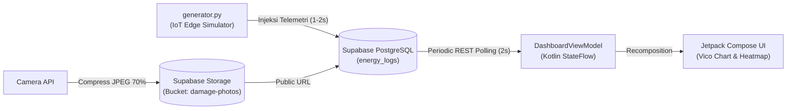
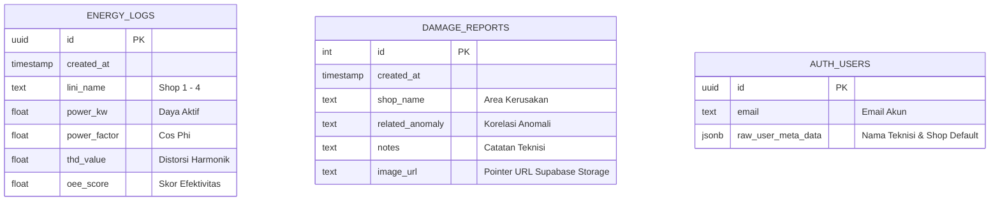

# AEMADS: Automated Energy Monitoring & Anomaly Detection System
> Industrial Android Application for Real-Time Power Monitoring & Predictive Maintenance.

---

## 1. Overview & Problem Definition

Di lini produksi manufaktur, kegagalan mesin akibat anomali kelistrikan (lonjakan beban *Spike* atau distorsi kualitas daya *Drift*) kerap terlambat dideteksi karena pemantauan tradisional masih terpusat di *Control Room*.

**AEMADS** mendesentralisasi pemantauan langsung ke tangan teknisi lapangan:
- **Mobile Telemetry Dashboard:** Visualisasi grafik daya aktif (*Power kW*), faktor daya (*Cos Phi*), *THD*, dan skor *OEE* secara live.
- **Global Heatmap Alarm:** Indikator visual real-time (Merah untuk *Spike*, Kuning untuk *Drift*) yang memantau 4 lini produksi (*Shop*) secara simultan.
- **Integrated Damage Reporting:** Pemotretan fisik mesin rusak dari kamera HP, otomatis dikompresi dan diunggah ke Supabase Storage, lalu ditautkan ke log anomali.
- **Export Data:** Unduh rekapitulasi data energi ke CSV dan PDF dengan satu klik.

---

## 2. Arsitektur & Alur Data



### Keputusan Arsitektur: 2s Periodic REST Polling
Sistem mengimplementasikan **Periodic REST Polling (interval 2 detik via `Kotlin Coroutines`)** sebagai pengganti WebSockets dengan pertimbangan:
1. **Bypass Firewall Enterprise:** Menghindari pemutusan sepihak koneksi TCP persisten (*WebSocket drop*) pada jaringan industri/kampus.
2. **Stateless Resilience:** Lebih tangguh terhadap fluktuasi sinyal saat teknisi bergerak di area *blank spot* pabrik.
3. **Efisiensi Database:** Kueri berindeks `LIMIT 20` ($O(1)$) menjaga beban server tetap minimal dan konsumsi baterai stabil.

---

## 3. Struktur Proyek

```text
Butkem_mobdev/
├── AEMADS/                      # Modul Aplikasi Android (Kotlin, Compose, MVVM)
│   ├── app/src/main/java/.../   # MainActivity, DashboardViewModel, Data Models
│   └── build.gradle.kts         # Dependensi Compose, Supabase SDK, Vico Chart, Coil
├── generator.py                 # Simulator Sensor IoT (Python) untuk injeksi data demo
├── .gitignore                   # Aturan pengabaian file log & cache
└── README.md                    # Dokumentasi utama proyek
```

---

## 4. Tech Stack

| Layer | Teknologi | Peran |
| :--- | :--- | :--- |
| **Mobile UI** | **Jetpack Compose (Kotlin)** | UI deklaratif reaktif, tema industri, animasi Heatmap. |
| **Architecture** | **MVVM + StateFlow** | Pemisahan tegas logika bisnis, UI state, dan background jobs. |
| **Backend & DB** | **Supabase (PostgreSQL & Storage)** | Database relasional untuk time-series log & bucket foto kerusakan. |
| **Data Fetching** | **Periodic REST Polling (2s)** | Penarikan data telemetri berkala yang tahan banting di jaringan industri. |
| **Visualisasi** | **Vico Chart** | Render grafik konsumsi daya *hardware-accelerated*. |
| **Image Loading** | **Coil Compose** | Asynchronous image loading & memory caching untuk feed laporan. |
| **IoT Simulator** | **Python (`requests`)** | Simulator mesin 4 Shop untuk menyuntikkan data normal dan anomali. |

---

## 5. Database Schema (ERD)



---

## 6. Cara Menjalankan

### 1. Jalankan IoT Simulator (Python)
```bash
pip install requests
python generator.py
```
> Simulator akan mengirim telemetri 4 Shop ke database Supabase secara otomatis.

### 2. Jalankan Aplikasi Android
1. Buka folder `AEMADS` di **Android Studio**.
2. Hubungkan HP Android atau nyalakan Emulator (min. API 26).
3. Jalankan aplikasi (`Shift + F10`), login, dan pantau dashboard secara live.
