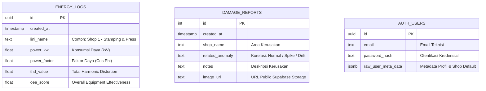

# ⚡ AEMADS: Automated Energy Monitoring & Anomaly Detection System
> *Industrial Mobile Application for Real-Time Power Monitoring & Predictive Maintenance*

---

## 📌 1. Latar Belakang & Definisi Masalah (Problem Statement)

Pada lingkungan industri manufaktur modern, efisiensi energi dan kesehatan mesin operasional adalah prioritas kritis. Masalah utama yang dihadapi di lantai produksi meliputi:

1. **Pendekatan Reaktif, Bukan Proaktif:** Pemeliharaan tradisional umumnya menunggu mesin mengalami kegagalan mekanis total (*downtime*) sebelum teknisi bertindak, yang menyebabkan kerugian finansial masif per menitnya.
2. **Keterlambatan Deteksi Anomali:** Gejala awal kerusakan seringkali terlihat dari pola konsumsi daya listrik—seperti lonjakan beban (*Spike*) akibat hentakan abnormal atau distorsi daya (*Drift*) karena ausnya komponen (misal bearing/hidrolik).
3. **Visibilitas Terbatas:** Data sensor kelistrikan biasanya hanya dapat dipantau melalui workstation stasioner di Ruang Kontrol Utama (*Central Control Room*), sehingga teknisi di lapangan tidak memiliki visibilitas *real-time* saat berpatroli.

---

## 💡 2. Solusi AEMADS

**AEMADS** menghadirkan solusi pemantauan berbasis cloud dan mobile:
- **Mobilitas Penuh:** Mentransformasi smartphone teknisi menjadi terminal monitoring portabel berbasis **Native Android (Jetpack Compose)**.
- **Peringatan Dini Cerdas (Global Heatmap):** Menyediakan alarm visual instan (indikator berkedip merah untuk Spike, kuning untuk Drift) saat anomali terdeteksi di lini produksi manapun (*Shop 1 - 4*).
- **Digitalisasi Pelaporan Kerusakan:** Integrasi kamera langsung ke cloud storage (*Supabase Storage*) dengan penautan ke log anomali listrik untuk pembuatan tiket perbaikan (*Damage Report*).
- **Ekspor Dokumen Satu Klik:** Kemudahan mengunduh riwayat telemetri dalam format Spreadsheet (CSV) maupun Dokumen Cetak (PDF).

---

## 🗂️ 3. Struktur Direktori Proyek

Proyek ini memisahkan antara **Klien Aplikasi Mobile (Android)** dan **Simulator Sensor IoT (Python)** untuk merefleksikan arsitektur sistem industri nyata:

```text
Butkem_mobdev/
├── AEMADS/                      # Source Code Aplikasi Android (Kotlin & Jetpack Compose)
│   ├── app/                     # Modul aplikasi Android
│   │   ├── src/main/java/       # Kode sumber Kotlin (MVVM Architecture)
│   │   │   └── com/example/aemads/
│   │   │       ├── MainActivity.kt        # Entry point & Deklaratif Composable UI
│   │   │       ├── DashboardViewModel.kt  # State Management & Network Layer
│   │   │       └── EnergyLog.kt           # Data Models & DTO
│   │   ├── build.gradle.kts     # Konfigurasi dependensi modul app
│   │   └── src/main/res/        # Resource Android (ikon, tema, XML config)
│   ├── build.gradle.kts         # Root Gradle build script
│   └── settings.gradle.kts      # Pengaturan modul Gradle
├── generator.py                 # IoT Sensor Simulator (Python Edge Simulator)
├── .gitignore                   # Konfigurasi ignore file Git
└── README.md                    # Dokumentasi utama proyek
```

> **Mengapa `AEMADS/` dan `generator.py` dipisah?**  
> - `AEMADS/` adalah proyek Android Studio yang dikompilasi menjadi berkas APK untuk perangkat seluler teknisi.
> - `generator.py` adalah skrip simulator IoT yang dijalankan di server/laptop pengembang untuk menginjeksi data telemetri 4 Shop secara berkala ke Supabase Database, menggantikan sensor fisik PLC/SCADA saat pengujian atau demo.

---

## 🔄 4. Alur Data (Data Flow Architecture)

```mermaid
flowchart TD
    subgraph IoT_Simulation [Layer IoT / Sensor Simulation]
        G["generator.py (Python)"]
    end

    subgraph Cloud_Infrastructure [Backend-as-a-Service (Supabase)]
        DB[("PostgreSQL Database\n(Table: energy_logs)")]
        S[("Storage Bucket\n(damage-photos)")]
    end

    subgraph Mobile_Application [Client Mobile App (Android)]
        VM["DashboardViewModel\n(Hybrid Polling 2s)"]
        UI["Jetpack Compose UI\n(Dashboard, Vico Chart, Heatmap)"]
        CAM["Android Camera API\n(TakePicturePreview)"]
    end

    %% Flow Generator
    G -- "1. Injeksi Telemetri 4 Shop (1s / 2s)\n& Trigger Anomali (Spike/Drift)" --> DB
    
    %% Flow Polling
    DB -- "2. REST API Fetch (LIMIT 20)" --> VM
    VM -- "3. StateFlow Emission" --> UI
    
    %% Flow Report & Image
    CAM -- "4. Ambil & Kompres Foto" --> VM
    VM -- "5. Upload Foto (JPEG 70%)" --> S
    S -- "6. Return Public URL" --> VM
    VM -- "7. Simpan Laporan + URL" --> DB
```

### ⚡ Keputusan Arsitektur: Hybrid Hard-Polling vs WebSockets
Dalam implementasi industri lapangan, sistem menggunakan **Hybrid Hard-Polling (REST API interval 2 detik)** melalui `Kotlin Coroutines` dan `StateFlow` dengan justifikasi teknis:
1. **Firewall & DPI (Deep Packet Inspection):** Jaringan enterprise/pabrik sering memblokir atau memutus koneksi WebSockets TCP persisten (*silent drop*).
2. **Ketahanan Sinyal Seluler:** Teknisi bergerak di area pabrik yang memiliki *blank spot*. Permintaan REST bersifat *stateless* sehingga jauh lebih andal pulih otomatis tanpa overhead *reconnect handshake*.
3. **Efisiensi Database:** Kueri dibatasi `LIMIT 20` terindeks, menjaga waktu komputasi PostgreSQL tetap $O(1)$ dengan latensi rendering UI tetap instan dan mulus.

---

## 📷 5. Mekanisme Kamera & Dual-Storage Architecture

Untuk mencatat kerusakan mesin secara visual tanpa membebani basis data:
1. **Delegasi Kamera (`ActivityResultContracts.TakePicturePreview`):** Menggunakan API kamera bawaan sistem operasi Android untuk efisiensi memori.
2. **Kompresi Gambar di Latar Belakang:** Foto berukuran 2-5 MB dikompresi di dalam `ViewModel` (`Bitmap.CompressFormat.JPEG, 70`) menjadi berkas ringkas (~200 KB).
3. **Dual-Storage Cloud Pattern:**
   - Berkas biner gambar diunggah langsung ke **Supabase Storage Bucket**.
   - Supabase mengembalikan *Public URL*.
   - Aplikasi menyimpan *Public URL* (teks pointer) bersama catatan teknisi ke tabel relasional SQL `damage_reports`.

---

## 📊 6. Database Schema & UML Use Case

### Skema Basis Data (Entity Relationship Diagram)



### Use Case Diagram

```mermaid
usecaseDiagram
    actor Teknisi as "Teknisi Lapangan"
    actor Supabase as "Supabase Cloud"
    
    package "AEMADS Mobile App" {
        usecase "Login & Ganti Shop Monitoring" as UC1
        usecase "Monitoring Grafik Daya Real-time" as UC2
        usecase "Pantau Status Global Heatmap" as UC3
        usecase "Ambil Foto Kerusakan Mesin" as UC4
        usecase "Kirim Tiket Laporan Kerusakan" as UC5
        usecase "Lihat Riwayat Kerusakan & Anomali" as UC6
        usecase "Export Data (CSV / PDF)" as UC7
    }
    
    Teknisi --> UC1
    Teknisi --> UC2
    Teknisi --> UC3
    Teknisi --> UC4
    Teknisi --> UC5
    Teknisi --> UC6
    Teknisi --> UC7
    
    UC1 <.. Supabase : Autentikasi JWT
    UC2 <.. Supabase : Polling Telemetri
    UC4 ..> UC5 : Lampiran Gambar
    UC5 ..> Supabase : Upload Storage & Insert SQL
```

---

## 🛠️ 7. Tech Stack

| Komponen | Teknologi | Alasan Pemilihan |
| :--- | :--- | :--- |
| **Mobile UI** | **Jetpack Compose (Kotlin)** | Paradigma deklaratif modern Android, rendering state-driven reaktif tanpa boilerplate XML. |
| **Mobile Architecture** | **MVVM (Model-View-ViewModel)** | *Separation of concerns* yang ketat antara logika bisnis, data flow, dan komponen tampilan. |
| **Cloud & Backend** | **Supabase (PostgreSQL & Storage)** | Arsitektur relasional tangguh untuk *time-series data*, manajemen sesi otentikasi aman, dan object storage. |
| **Data Fetching** | **Kotlin Coroutines & StateFlow** | Eksekusi jaringan asinkron non-blocking di background thread dengan kontrol siklus hidup Android yang aman. |
| **Data Visualization** | **Vico Chart** | Rendering grafik garis kelistrikan interaktif dengan akselerasi perangkat keras (*hardware-accelerated*). |
| **Image Loading** | **Coil Compose** | Pustaka pemroses gambar asinkron dengan fitur *memory & disk caching* otomatis. |
| **IoT Simulator** | **Python 3 (`requests`, `math`)** | Skrip ringan untuk mensimulasikan dinamika gelombang sinus dan injeksi anomali multi-shop. |

---

## 🚀 8. Panduan Menjalankan Sistem (Getting Started)

### Prasyarat
- **Android Studio** Ladybug / Hedgehog atau versi terbaru dengan Android SDK 34+.
- Perangkat fisik Android atau Android Emulator (API level 26+).
- **Python 3.8+** terpasang di komputer/laptop.

### Langkah 1: Jalankan Simulator IoT (Python)
Buka terminal pada direktori root proyek dan jalankan:
```bash
# Install dependency requests (jika belum ada)
pip install requests

# Jalankan simulator data sensor
python generator.py
```
> Skrip akan mulai mengirim data telemetri untuk 4 Shop (Stamping, Welding, Body, Paint) ke Supabase setiap 2 detik.

### Langkah 2: Jalankan Aplikasi Android
1. Buka folder `AEMADS` di **Android Studio**.
2. Tunggu proses **Gradle Sync** selesai.
3. Hubungkan perangkat Android via USB Debugging / jalankan Android Virtual Device (AVD).
4. Klik tombol **Run ('app')** (Shift + F10).
5. Masuk ke aplikasi dan pilih Shop yang ingin dipantau untuk melihat grafik bergerak secara langsung!
